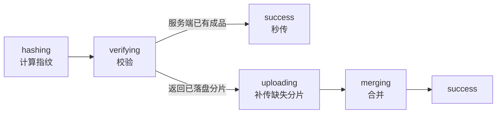

# ChunkUpload

通用 Vue 3 大文件上传组件：拖拽 / 多文件、类型与大小校验、图片预览、MD5/SHA 秒传、分片并发上传、断点续传、暂停 / 继续 / 取消、失败自动重试、多文件排队。

## 代码结构

逻辑按「视图 → 队列 → 任务 → 接口」四层拆分，每层只做一件事：

```
index.vue            视图：拖拽区、文件列表、操作按钮（不含任何上传逻辑）
useChunkUpload.js    队列：文件列表、排队调度、暂停 / 继续 / 移除 / 批量操作、v-model 同步与对外事件
upload-task.js       任务：单个文件的 hash → verify → 分片并发上传 → merge（纯异步逻辑，不依赖 Vue）
chunk-api.js         接口：verify / uploadChunk / merge / cancel 的默认 HTTP 协议，可由 props.api 接管
chunk-hash.js        指纹：Web Worker + hash-wasm 计算文件哈希（Worker 不可用时降级主线程）
helpers.js           纯函数：状态判断、文件项归一化、AbortSignal 工具
```

单个文件的流水线（`upload-task.js`）：



文件项状态：`ready → queued → hashing → verifying → uploading → merging → success`，除 `merging` 外都可 `paused`，失败进入 `error`，`继续 / 重试` 回到 `queued`。

几条约定：

- **服务端是断点的唯一依据**：暂停 / 重试 / 刷新后重新选择同一文件，都是重新跑一遍流水线，由 `verify` 返回已落盘的分片，只补传缺失的部分；指纹在内存里复用，不会重复计算。前端不再用 localStorage 记录进度（服务端清理分片后，本地记录会让合并失败）。
- **暂停 / 取消统一走 `AbortSignal`**：fetch、XHR、Worker、重试等待都据此立即结束；移除一个已有断点的文件时会通知服务端清理临时分片。
- **并发有两层**：`fileConcurrency` 控制同时处理的文件数（其余显示「排队中」），`concurrency` 控制单个文件同时上传的分片数。
- **分片失败自动重试** `maxRetry` 次（间隔 `retryDelay`）；4xx 与业务失败（`code !== 200`）重试无意义，直接失败。

## 基本用法

```vue
<ChunkUpload
  v-model="files"
  action="http://localhost:5320/api/upload"
  :headers="{ Authorization: `Bearer ${token}` }"
  accept=".zip,.pdf,image/*"
  :chunk-size="5 * 1024 * 1024"
  :concurrency="3"
  :before-upload="beforeUpload"
  @success="onSuccess"
/>
```

`v-model` 始终按数组处理，组件内部持有上传状态、只回写快照；外部替换数组时按 `uid` 对账（已有项保留其运行中的任务，新增项归一化，缺失项释放）。回显数据直接传入：

```js
const files = ref([
  { uid: 'remote-1', name: '产品手册.pdf', size: 1024 * 1024, status: 'success', url: 'https://cdn.example.com/manual.pdf' }
])
```

## Props

| 属性 | 默认 | 说明 |
| --- | --- | --- |
| `modelValue` | `[]` | 文件列表（数组） |
| `action` | `''` | 默认协议的基础地址，派生 `${action}/verify`、`/chunk`、`/merge`、`/cancel` |
| `verifyUrl` / `chunkUrl` / `mergeUrl` / `cancelUrl` | `''` | 分别覆盖上面四个地址 |
| `api` | `{}` | 接管 `verify` / `uploadChunk` / `merge` / `cancel` 中的任意一个，见下文 |
| `headers` | `{}` | 附加请求头（如 `Authorization`），每次请求时读取最新值 |
| `data` | `{}` | 附加到每个请求的额外参数（对象或返回对象的函数）；分片请求中拼进 query |
| `withCredentials` | `false` | 跨域携带 Cookie |
| `chunkSize` | `5 MB` | 单个分片大小，需在服务端允许的范围内 |
| `concurrency` | `3` | 单个文件同时上传的分片数 |
| `fileConcurrency` | `2` | 同时上传的文件数，其余排队 |
| `maxRetry` / `retryDelay` | `3` / `1000` | 单个分片失败后的重试次数与间隔（ms） |
| `hashAlgorithm` | `md5` | `md5` / `sha1` / `sha-1` / `sha256` / `sha-256`，服务端按哈希长度识别 |
| `hashChunkSize` | `2 MB` | 计算指纹时单次读取的字节数 |
| `maxSize` | `0` | 单文件上限（MB），`0` 不限制 |
| `accept` | `''` | 允许的类型：扩展名、`image/*`、完整 MIME |
| `multiple` / `limit` | `true` / `0` | 多文件与数量上限；单文件模式下新文件替换旧文件 |
| `drag` | `true` | 是否支持拖拽 |
| `autoUpload` | `true` | 选择后自动开始；关闭时用行内「开始」按钮或 `submit()` |
| `disabled` | `false` | 禁用 |
| `beforeUpload` | `null` | `(file, files) => boolean \| File \| Promise`，返回 `false` 取消，返回 `File` 替换 |

## 事件

| 事件 | 载荷 |
| --- | --- |
| `update:modelValue` / `change` | 文件项数组快照（状态切换立即回写，进度每 200ms 合并回写） |
| `before-upload` | `file` |
| `progress` | `{ item, percent, uploadedChunks, phase }`，`phase` 为当前状态（`hashing` 时 `percent` 是指纹进度） |
| `success` | `{ item, response, method }`，`method` 为 `fast`（秒传）或 `chunk` |
| `error` | `{ item?, file?, error?, phase, message }`，`phase` 为 `validate` / `before-upload` / `upload` |
| `remove` | 被移除的文件项 |
| `preview` | 被预览的文件项 |

通过模板 ref 可调用：`submit()`（开始全部待上传）、`pauseAll()`、`resumeAll()`、`cancelAll()`。

## 默认 HTTP 协议

服务端实现见 `apps/server/src/modules/upload`，响应采用业务信封 `{ code, msg, data }`，`code !== 200` 视为失败。

| 接口 | 请求 | 返回（`data`） |
| --- | --- | --- |
| `POST ${action}/verify` | JSON：`fileHash` `fileName` `fileSize` `chunkSize` `totalChunks` | `{ exists, url?, uploadedChunks }` |
| `POST ${action}/chunk` | query：`fileHash` `fileName` `fileSize` `chunkSize` `totalChunks` `chunkIndex`；**请求体为分片二进制**（`application/octet-stream`） | `{ index }` |
| `POST ${action}/merge` | JSON：同 `verify` | `{ url }` |
| `POST ${action}/cancel` | JSON：`fileHash` | — |

分片放在请求体而不是 multipart：服务端可以直接流式写盘，不需要 multipart 解析器；`data` 属性的额外参数会同时拼进 JSON 与 query。

## 自定义 API

不想用默认协议（例如直传对象存储）时传入 `api`，四个函数都可选，未提供的仍走默认协议：

```js
const api = {
  // 返回 { exists, url?, uploadId?, uploadedChunks? }，亦可返回 { data: {...} } 信封
  verify: async ({ file, item, fileHash, totalChunks, chunkSize, uploadId, signal }) => ({ exists: false, uploadedChunks: [] }),
  // 上传一个分片；通过 onProgress(loaded, total) 回报进度；signal 触发时应尽快中止
  uploadChunk: async ({ chunk, index, fileHash, uploadId, onProgress, signal }) => {
    signal.throwIfAborted()
    onProgress(chunk.size, chunk.size)
  },
  // 返回 { url }（亦兼容 fileUrl / downloadUrl）
  merge: async ({ fileHash, uploadId, totalChunks, signal }) => ({ url: `/files/${fileHash}` }),
  // 用户移除未完成的文件时调用，用于清理服务端临时数据；失败会被忽略
  cancel: async ({ fileHash, uploadId }) => {}
}
```

抛出的错误带 `retryable: false` 时不会重试；`signal` 被中止时抛出任意错误即可，组件以主动暂停 / 取消的意图为准。

## 从旧版迁移

- `api.*` 上下文里的 `task`（`task.cancelled` 等）已移除，改用标准的 `signal`（`signal.aborted` / `signal.throwIfAborted()`）。
- 默认分片地址由 `${action}` 改为 `${action}/chunk`，分片请求体由 multipart 改为二进制流；删除不再有意义的 `chunkField`、`fileField`。
- 不再使用 localStorage 记录断点，以服务端 `verify` 结果为准。
- `concurrency` 的含义由「全组件」改为「单个文件」；同时处理的文件数由新增的 `fileConcurrency` 控制。
